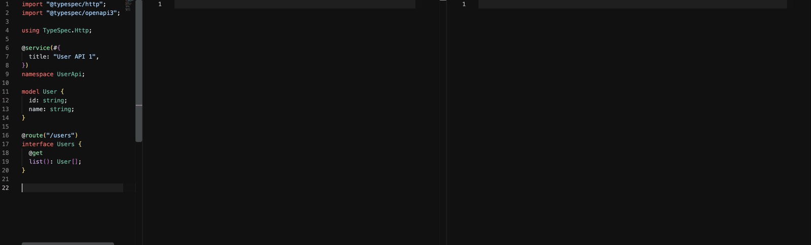

# Template

Scaffolds the app entry and one handler file per first path segment around the generated routes.

```ts
import { defineConfig } from 'hono-takibi'

export default defineConfig({
  input: 'openapi.yaml',
  output: './src/routes.ts',
  pathAlias: '@/', // the files import one another as `@/routes`, `@/handlers` instead of relative paths
  template: {},
})
```

Generated files:

- `src/index.ts`: app entry that registers every handler
- `src/handlers/*.ts`: handler stubs, one file per first path segment

## Path alias with `imports`

A `pathAlias` that starts with `#` is package.json `imports`, the alias Node resolves without a bundler. Write the mapping once, as the Node and TypeScript docs do:

```json
// package.json
{ "imports": { "#/*": "./src/*" } }
```

```json
// tsconfig.json
{ "compilerOptions": { "allowImportingTsExtensions": true } }
```

```ts
// hono-takibi.config.ts
export default defineConfig({
  input: 'openapi.yaml',
  output: './src/routes.ts',
  pathAlias: '#/',
  template: { routeHandler: true },
})
```

Through `imports`, Node, tsc and esbuild neither add an extension nor resolve a directory to its `index.ts`. So every import between generated files names its file:

| `@/` alias                | `#/` alias                   |
| ------------------------- | ---------------------------- |
| `from '@/routes'`         | `from '#/routes.ts'`         |
| `from '@/handlers'`       | `from '#/handlers/index.ts'` |
| `from '@/index'`          | `from '#/index.ts'`          |
| `export * from './users'` | `export * from './users.ts'` |

The app then runs on Node from its sources (`node src/index.ts`), under tsc with `moduleResolution: "nodenext"`, and in Vite or esbuild alike.

- `allowImportingTsExtensions` is what lets tsc accept a `.ts` specifier. Code you write against a `#` alias needs it as well.
- Map the alias without an extension (`"./src/*"`). A mapping that ends in `.ts` (`"./src/*.ts"`) would double it.
- A `#/` prefix needs Node 24.14 or 25.4 and later. On older Node, name the prefix (`"#src/*": "./src/*"`, `pathAlias: '#src/'`).
- An alias declared only in tsconfig `paths` should not start with `#`: `#` is reserved for package.json `imports`. Use `@/` or `~/` for it.

## Re-running is safe

Run it again after editing the spec. New operations get a stub, existing handlers keep the code you wrote.

- A handler you moved into another file is regenerated in place.
- When an operation leaves the spec, its handler declaration is removed. The file stays, delete it by hand when it is empty.
- Files under `handlers/` are never deleted. Only top-level files are scanned, not subdirectories.

## File names

A handler file is named after the first segment of the path, in kebab-case. Tags do not affect it: `/events` and `/events/{id}` go to `events.ts` whatever their tags.

| Path                     | File                  | Export (`routeHandler: false`) |
| ------------------------ | --------------------- | ------------------------------ |
| `/real-time-events/{id}` | `real-time-events.ts` | `realTimeEventsHandler`        |
| `/api_keys`              | `api-keys.ts`         | `apiKeysHandler`               |
| `/v2-public/ping`        | `v2-public.ts`        | `v2PublicHandler`              |
| `/`                      | `__root.ts`           | `__rootHandler`                |
| `/index`, `/{index}`     | `__index.ts`          | `__indexHandler`               |

`index.ts` is the barrel that re-exports every handler file, so the segment `index` is written to `__index.ts`.

Only the file name is kebab-case. Exports and `split` groups are camelCase.

```ts
// src/handlers/real-time-events.ts
export const realTimeEventsHandler = app.openapi(getRealTimeEventsRoute, (c) => {})
```

A file that already holds a handler keeps its name. A project generated with camelCase names (`realTimeEvents.ts`), or with files named after tags, is not renamed and its handlers stay where they are. Only new operations are written to the file of their path. Rename the files yourself if you want them in kebab-case, the generator follows them.

## Modes

### `routeHandler: false` (default)

Each handler file creates its own sub-router. The app mounts them with `.route()`.

```ts
// src/handlers/health.ts
import { OpenAPIHono } from '@hono/zod-openapi'

import { getHealthRoute } from '@/routes'

const app = new OpenAPIHono()

export const healthHandler = app.openapi(getHealthRoute, (c) => {})
```

```ts
// src/index.ts
import { OpenAPIHono } from '@hono/zod-openapi'

import { healthHandler } from './handlers'

const app = new OpenAPIHono()

export const api = app.route('/', healthHandler)

export default app
```



::: tip
If you split routes into hand-written files, name each sub-router export `<fileBasename>Handler`, for example `sharesHandler` in `shares.ts`. That is the name the generator merges into. A kebab-case file goes by its camelCase name: `shareLinksHandler` in `share-links.ts`.
:::

### `routeHandler: true`

Handlers export typed `RouteHandler` functions. Route registration lives in `index.ts`.

```ts
// src/handlers/health.ts
import type { RouteHandler } from '@hono/zod-openapi'

import type { getHealthRoute } from '../routes'

export const getHealthRouteHandler: RouteHandler<typeof getHealthRoute> = async (c) => {}
```

```ts
// src/index.ts
import { OpenAPIHono } from '@hono/zod-openapi'

import { getHealthRouteHandler } from './handlers'
import { getHealthRoute } from './routes'

const app = new OpenAPIHono()

export const api = app.openapi(getHealthRoute, getHealthRouteHandler)

export default app
```


### `define: true`

Route and handler live together in one `defineOpenAPIRoute()` call.

```ts
export default defineConfig({
  input: 'openapi.yaml',
  template: { define: true },
})
```

```ts
// src/routes/users.ts
export const getUsersIdRoute = defineOpenAPIRoute({
  route: createRoute({
    method: 'get',
    path: '/users/{id}',
    request: { params: z.object({ id: z.string() }) },
    responses: {
      200: { description: 'ok', content: { 'application/json': { schema: UserSchema } } },
    },
  }),
  handler: async (c) => {},
  addRoute: true,
})
```


In this mode `output` is the app entry (default `./src/index.ts`, must be an `index.ts` path). Routes go to `routes/` next to it, and component schemas to `components/index.ts`.

## Splitting the app

`split: true` exports one group per first path segment, the root `/` as `__root`. See [Client](/docs/guides/client#larger-applications).

```ts
export default defineConfig({
  input: 'openapi.yaml',
  output: './src/routes.ts',
  template: { routeHandler: true, split: true },
})
```

```ts
// src/index.ts
const app = new OpenAPIHono()

export const __root = app.openapi(getRoute, getRouteHandler)

export const books = app
  .openapi(getBooksRoute, getBooksRouteHandler)
  .openapi(postBooksRoute, postBooksRouteHandler)

export default app
```

Works with `routeHandler: true`, `routeHandler: false` and `define: true`. Re-running keeps your own exports.
