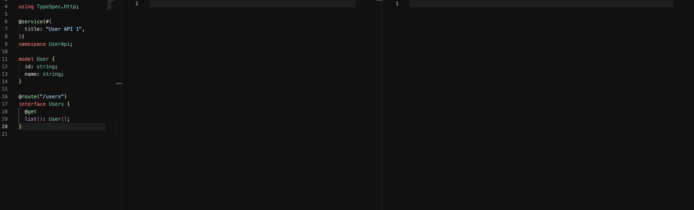
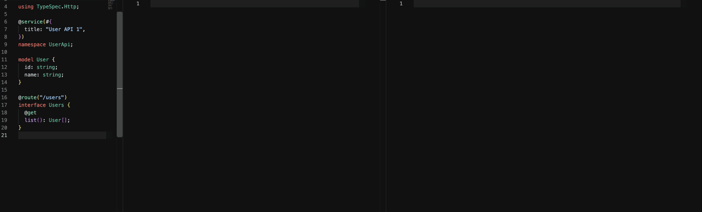

# Template

Scaffolds the app entry and one handler file per tag around the generated routes.

```ts
import { defineConfig } from 'hono-takibi'

export default defineConfig({
  input: 'openapi.yaml',
  output: './src/routes.ts',
  pathAlias: '@/', // the files import one another as `@/routes`, `@/handlers` instead of relative paths
  template: {},
})
```

Generated files:

- `src/index.ts`: app entry that registers every handler
- `src/handlers/*.ts`: handler stubs, one file per tag

## Re-running is safe

Run it again after editing the spec. New operations get a stub, existing handlers keep the code you wrote.

- A handler you moved into another file is regenerated in place.
- When an operation leaves the spec, its handler declaration is removed. The file stays, delete it by hand when it is empty.
- Files under `handlers/` are never deleted. Only top-level files are scanned, not subdirectories.

## File names

A handler file is named after the first tag of its operations, or the first path segment when there is no tag, in kebab-case.

| Tag or path        | File                  | Export (`routeHandler: false`) |
| ------------------ | --------------------- | ------------------------------ |
| `Real-Time Events` | `real-time-events.ts` | `realTimeEventsHandler`        |
| `API Keys`         | `api-keys.ts`         | `apiKeysHandler`               |
| `/v2-public/ping`  | `v2-public.ts`        | `v2PublicHandler`              |
| `/`                | `__root.ts`           | `__rootHandler`                |

Only the file name is kebab-case. Exports and `split` groups are camelCase.

```ts
// src/handlers/real-time-events.ts
export const realTimeEventsHandler = app.openapi(getEventsRoute, (c) => {})
```

A file that already holds a handler keeps its name. A project generated with camelCase names (`realTimeEvents.ts`) is not renamed, and new operations of a tag join the file that tag already has. Rename the files yourself if you want them in kebab-case, the generator follows them.

## Modes

### `routeHandler: false` (default)

Each handler file creates its own sub-router. The app mounts them with `.route()`.

```ts
// src/handlers/health.ts
import { OpenAPIHono } from '@hono/zod-openapi'

import { getHealthRoute } from '@/routes'

const app = new OpenAPIHono()

export const healthHandler = app.openapi(getHealthRoute, (c) => {})
```

```ts
// src/index.ts
import { OpenAPIHono } from '@hono/zod-openapi'

import { healthHandler } from './handlers'

const app = new OpenAPIHono()

export const api = app.route('/', healthHandler)

export default app
```


::: tip
If you split routes into hand-written files, name each sub-router export `<fileBasename>Handler`, for example `sharesHandler` in `shares.ts`. That is the name the generator merges into. A kebab-case file goes by its camelCase name: `shareLinksHandler` in `share-links.ts`.
:::

### `routeHandler: true`

Handlers export typed `RouteHandler` functions. Route registration lives in `index.ts`.

```ts
// src/handlers/health.ts
import type { RouteHandler } from '@hono/zod-openapi'

import type { getHealthRoute } from '../routes'

export const getHealthRouteHandler: RouteHandler<typeof getHealthRoute> = async (c) => {}
```

```ts
// src/index.ts
import { OpenAPIHono } from '@hono/zod-openapi'

import { getHealthRouteHandler } from './handlers'
import { getHealthRoute } from './routes'

const app = new OpenAPIHono()

export const api = app.openapi(getHealthRoute, getHealthRouteHandler)

export default app
```



### `define: true`

Route and handler live together in one `defineOpenAPIRoute()` call.

```ts
export default defineConfig({
  input: 'openapi.yaml',
  template: { define: true },
})
```

```ts
// src/routes/users.ts
export const getUsersIdRoute = defineOpenAPIRoute({
  route: createRoute({
    method: 'get',
    path: '/users/{id}',
    request: { params: z.object({ id: z.string() }) },
    responses: {
      200: { description: 'ok', content: { 'application/json': { schema: UserSchema } } },
    },
  }),
  handler: async (c) => {},
  addRoute: true,
})
```



In this mode `output` is the app entry (default `./src/index.ts`, must be an `index.ts` path). Routes go to `routes/` next to it, and component schemas to `components/index.ts`.

## Splitting the app

`split: true` exports one group per first path segment, the root `/` as `__root`. See [Client](/docs/guides/client#larger-applications).

```ts
export default defineConfig({
  input: 'openapi.yaml',
  output: './src/routes.ts',
  template: { routeHandler: true, split: true },
})
```

```ts
// src/index.ts
const app = new OpenAPIHono()

export const __root = app.openapi(getRoute, getRouteHandler)

export const books = app
  .openapi(getBooksRoute, getBooksRouteHandler)
  .openapi(postBooksRoute, postBooksRouteHandler)

export default app
```

Works with `routeHandler: true`, `routeHandler: false` and `define: true`. Re-running keeps your own exports.
