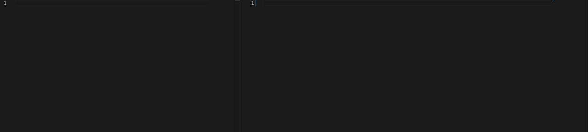

# Vite Plugin

Runs `hono-takibi.config.ts` from Vite. The dev server generates on startup and again when the spec or the config is saved; `vite build` generates once before it bundles, and fails if the generation does.

```ts
// vite.config.ts
import { honoTakibiVite } from 'hono-takibi/vite-plugin'
import { defineConfig } from 'vite'

export default defineConfig({
  plugins: [honoTakibiVite()],
})
```

The config file is read from Vite's [`root`](https://vite.dev/config/shared-options#root), and the paths in it are resolved from there too. See [Configuration](/docs/guides/config) for its contents.

## Options

| Option   | Default                 | Description                               |
| -------- | ----------------------- | ----------------------------------------- |
| `config` | `hono-takibi.config.ts` | The config file, as a path from the root. |

```ts
honoTakibiVite({ config: 'config/hono-takibi.config.ts' })
```

## Demo


